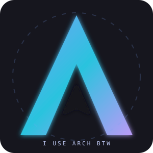

# 👋 Hey, I'm Walman!

<div align="center">



# `WaLMaN-s`

### Linux Enthusiast · Full Stack Developer · Open Source Explorer


[](https://github.com/WaLMaN-s)
[](https://walman-s.github.io/myportofolio/)
[](https://archlinux.org/)

</div>

---

## 🧑‍💻 About Me

```bash
┌──(walman㉿archlinux)-[~]
└─$ whoami

Username   : WaLMaN-s
OS         : Arch Linux
WM         : i3 Window Manager
Interests  : Web Development, Linux, Open Source
```

- 🔭 Currently building modern web applications.
- 🌱 Exploring Linux, backend development, and system infrastructure.
- 💻 Working with Laravel, Next.js, React, and TypeScript.
- 🐧 Daily driving Arch Linux with i3 Window Manager.
- ⚡ I enjoy customizing Linux environments and exploring new technologies.

---

## 🛠️ Languages and Tools

<div align="center">

### Programming Languages


### Frontend Development


### Backend Development


### Database


### Operating Systems and Tools


</div>

---

## 🔥 GitHub Statistics

<div align="center">


</div>

---

## 🐍 Contribution Snake

<div align="center">


</div>


---

## 🌐 Connect With Me

<div align="center">

[](https://github.com/WaLMaN-s)
[](https://walman-s.github.io/myportofolio/)

</div>

---

<div align="center">

### `~$ echo "I use Arch, btw."`


**Thanks for visiting my profile!** 💙

</div>
